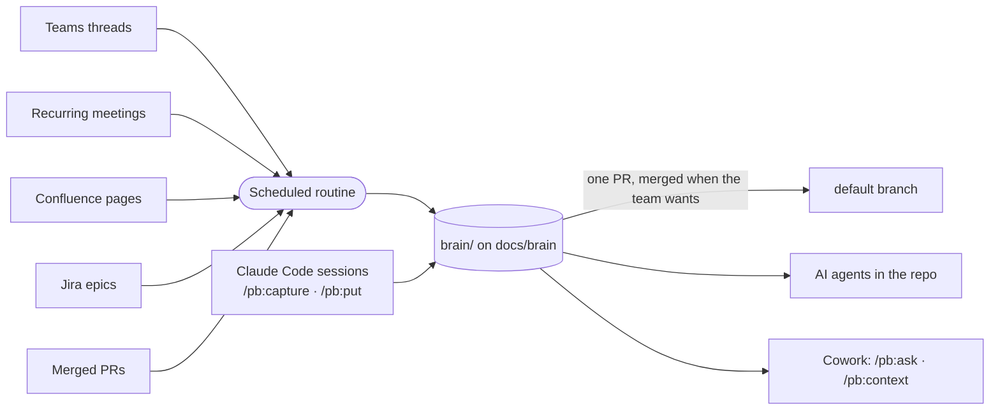

<div align="center">

# 🧠 Project Brain

**Your product team's shared memory, inside the repo, for people and AI agents.**

A Claude plugin that turns Teams threads, Confluence analyses, Jira epics and developer sessions<br>
into a linked wiki of features, epics, concepts, modules and decisions, right next to your code.

[](LICENSE)
[](#-install)
[](#-install)
[](#-set-up)

[Install](#-install) · [Set up](#-set-up) · [What you get for free](#-what-you-get-for-free) · [Commands](#-commands) · [Troubleshooting](#-troubleshooting)

</div>

---

## ✨ Why

Decisions get made in a Teams thread, requirements live in a Confluence page, the reasons behind the code sit in someone's head. AI agents working on your repo see none of it.

Project Brain collects that context into `brain/`, a folder of plain Markdown pages in your monorepo. It keeps only what matters, keeps it short, and links it all together.

| Who | Where | How they use it |
|---|---|---|
| 👩‍💻 **Developers** | Claude Code | Read and write the brain; their working branch is never touched |
| 🧑‍🎨 **PMs, designers, analysts, QA** | Claude Code (desktop app) | Read and write the brain without knowing git: `/pb:setup` prepares the computer once |
| 👀 **Anyone, read-only** | Claude Cowork | Ask questions and get context through the GitHub connector |
| 🤖 **AI agents** | Any session in the repo | Read `brain/AGENTS.md` and the context packs before touching code |



## 📦 Install

<details open>
<summary><b>Claude Code</b></summary>

```
/plugin marketplace add minox86/project-brain
/plugin install pb@project-brain
```

</details>

<details open>
<summary><b>Claude Cowork, just for you</b></summary>

1. Open **Customize** in the sidebar, then **Plugins**.
2. Select **Add marketplace** and enter `minox86/project-brain`.
3. Find **pb** and click **Install**.
4. Connect the **GitHub** connector with read access to your product monorepo. Cowork reads the brain from there.

</details>

<details>
<summary><b>Claude Cowork, for the whole team</b> (organization Owner)</summary>

Organization marketplaces must be **private or internal** repositories on github.com.

1. Fork or mirror this repo as a private repo in your GitHub organization.
2. Sync it from **Organization settings → Plugins**.
3. Make `pb` available, or required, for the product team.

Cowork and Skills must be enabled for the organization.

</details>

## 🚀 Set up

Once per product.

### 1 · Create the brain

> **Who:** a developer or the Engineering Manager, in Claude Code · **Needs:** Python 3.9+, git, `gh` logged in

1. Open the monorepo and run **`/pb:init`**. Your checkout is not touched: init works in a temporary copy.
2. Claude looks at the repo, then asks a few rounds of questions to shape the wiki around your product, including which parts of it need a human review and who reviews technical, functional and design changes. The recommended answer is always the first option.
3. Confirm. Claude creates the branch `docs/brain` with `brain/`, two GitHub workflows and the first pages, and opens the PR from `docs/brain` to your default branch.
4. Merge that PR: it turns on the workflows.

**How it works from then on.** The brain lives on `docs/brain`. Every save goes straight there, so everyone sees it at once; only pages on watched points wait for a reviewer in a PR. pb keeps one PR open from `docs/brain` to the default branch: merge it when you want the code branches to carry the brain, with any merge method. Your default branch keeps its protection; `docs/brain` must stay open to pushes from the team.

> [!IMPORTANT]
> `docs/brain` must not be covered by a branch protection or ruleset, and workflows must be allowed to push to it (`contents: write`). `/pb:init` checks both and tells you what an admin must change.

> [!NOTE]
> Coming from an earlier version, with the brain on the default branch? Run `/pb:init` again: it moves the brain to `docs/brain`.

### 1b · Everyone else

> **Who:** each person who will use the brain, in Claude Code (the desktop app is fine) · **Needs:** write access to the monorepo

Run **`/pb:setup`**. Claude installs what is missing (git, Python, GitHub CLI), signs you in to GitHub, clones the monorepo and checks that you can read the brain. Then ask the brain anything, or save what you know: no git involved.

### 2 · Set up the routine

> **Who:** the Engineering Manager, in Claude Code · **Needs:** Microsoft 365 and Atlassian connectors

1. Run **`/pb:routine-setup`** and pick:
   - the Teams channels and Confluence spaces to read;
   - the recurring meetings to follow (refinement, design review, demo…): they need transcription on and the routine owner invited;
   - the Jira projects whose epics to follow;
   - how often it runs: every night (default), weekdays only, a few times a day, every N hours, once a week, or a custom schedule. At most once an hour.
2. Claude creates the routine (or prints the steps) and starts a first run.
3. Check `brain/digests/<today>.md` to see what was added and what was skipped.

## 🎁 What you get for free

Once the brain and the routine are set up, these happen without anyone running a command:

- 🔄 **Teams, Confluence and Jira flow in on schedule.** The routine keeps only what is worth remembering (decisions, requirement clarifications, domain explanations, open questions). It never copies messages verbatim and writes a digest of what it added and skipped.
- 🎙️ **Recurring meetings are captured.** After each refinement or design review, the routine reads the transcript and keeps the decisions and open questions. The transcript itself is never stored.
- 🎯 **Epics stay in sync.** Discussions that mention a Jira epic key are filed under that epic. When the epic is done, what still matters moves to the feature and decision pages.
- 🤖 **Every Claude session in the repo knows the brain**, even without the plugin. `CLAUDE.md` points to `brain/AGENTS.md`. Claude then:
  - uses the glossary terms;
  - starts from the context of your feature or epic;
  - follows accepted decisions;
  - flags code that contradicts the brain.
- ✅ **The brain checks itself.** Every save is validated before it leaves your computer, and CI checks it again: broken links, malformed pages and anything that looks like a password or token. The PR towards the default branch fails if `docs/brain` carries anything other than the brain.
- 🔇 **Noise is caught as it is written.** New pages that look like an existing one, pages nobody links, claims without a source, dated "update" sections, status talk ("this sprint", "TODO") and long verbatim quotes are flagged before the save.
- 👀 **Sensitive changes wait for the right reviewer.** `brain/schema/review.md`, written by `/pb:init` and changed with `/pb:schema`, lists the points that need a human (decisions, interfaces, feature status…) and who reviews technical, functional and design changes. Saves and the routine push what passes and open a PR, with those reviewers, for the rest.
- 📚 **Indexes stay fresh.** Every save rebuilds the index, the bilingual glossary and a context pack for every feature and active epic.
- 🧹 **Old items step aside.** Superseded decisions, answered questions and closed epics leave the index after a while. Git keeps the history.
- 💬 **No commands to remember.** Ask in plain words: *"what did we decide about approvals?"*, *"save this decision in the brain"*, *"give me the context for FIN-412"*.

## 🛠 Commands

**In Claude Code (everyone)**

| You want to… | Say it, or run |
|---|---|
| Get context before a ticket | `/pb:context FIN-412` (or a feature, an epic, file paths) |
| Ask something | `/pb:ask why do invoices have a single approver?` |
| Save what you learned in this session | `/pb:capture` |
| Add a document, Confluence page or Jira ticket | `/pb:put <file \| link \| jira:KEY \| text>` |
| Save a one-off Teams meeting | `/pb:meeting last` |
| Correct something wrong | `/pb:fix <what is wrong and what is right>` |
| Clean up the brain | `/pb:lint --fix` |
| Run the routine now | `/pb:routine-run` (`--local` to run it here, `--check` to preview) |
| Change how often the routine runs | `/pb:routine-setup schedule every 4 hours` |
| Change the wiki structure | `/pb:schema` |

Saves go straight to `docs/brain`, never to your working branch. If someone changed the same page meanwhile, Claude merges both versions for you.

**In Cowork (read-only)**

| You want to… | Say it, or run |
|---|---|
| Ask something | `/pb:ask what is still open on multi-level approval?` |
| Get the full context | `/pb:context <feature, epic or Jira key>` |

> [!TIP]
> Cowork only reads the brain. To add knowledge, use Claude Code (`/pb:setup` prepares it once), or write where you already do: analyses on Confluence, discussions in the Teams channel. Mention the Jira epic key and the routine files the content under that epic.

## 🩺 Troubleshooting

| Symptom | What to do |
|---|---|
| A connector is missing (Atlassian, Microsoft 365, GitHub) | The command names it, shows how to connect it and offers a workaround. In Cowork: **Customize → Connectors**. Some connectors need an organization Owner to enable them. |
| Cowork says the brain is not reachable | Connect GitHub with read access to the monorepo |
| "Saved on this computer" | You were offline: the next save sends it |
| The brain in my code branch is old | It arrives with the PR from `docs/brain`; the `pb` skills always read the latest |
| `pb-brain-branch` failed | Someone edited `brain/` on the default branch: merge the default branch into `docs/brain` by hand, keeping the `docs/brain` pages |
| Nothing was added overnight | Read "Problems" in the latest digest in `brain/digests/` |
| Wrong information | `/pb:fix` in Claude Code |
| The plugin was updated | In the monorepo, ask Claude to run `pb toolkit-sync` and save it, so CI and the routine use the new version (cloud routines load no plugins: they follow the copy in `brain/.pb/toolkit/`) |

<div align="center">
<sub>MIT licensed · built for <a href="https://claude.com/claude-code">Claude Code</a> and Claude Cowork</sub>
</div>
