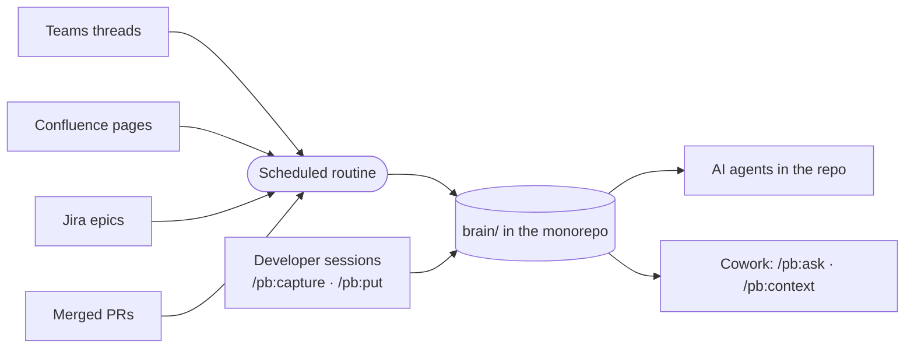

<div align="center">

# 🧠 Project Brain

**Your product team's shared memory, inside the repo, for people and AI agents.**

A Claude plugin that turns Teams threads, Confluence analyses, Jira epics and developer sessions<br>
into a linked wiki of features, epics, concepts, modules and decisions, right next to your code.

[](LICENSE)
[](#-install)
[](#-install)
[](#-set-up)

[Install](#-install) · [Set up](#-set-up) · [What you get for free](#-what-you-get-for-free) · [Commands](#-commands) · [Troubleshooting](#-troubleshooting)

</div>

---

## ✨ Why

Decisions get made in a Teams thread, requirements live in a Confluence page, the reasons behind the code sit in someone's head. AI agents working on your repo see none of it.

Project Brain collects that context into `brain/`, a folder of plain Markdown pages in your monorepo. It keeps only what matters, keeps it short, and links it all together.

| Who | Where | How they use it |
|---|---|---|
| 👩‍💻 **Developers** | Claude Code | Read and write the brain; changes ship with their PR |
| 🧑‍🎨 **PMs, designers, analysts, QA** | Claude Cowork | Ask questions and get briefings; they keep writing on Confluence and Teams, and the routine brings it in |
| 🤖 **AI agents** | Any session in the repo | Read `brain/AGENTS.md` and the context packs before touching code |



## 📦 Install

<details open>
<summary><b>Claude Code</b></summary>

```
/plugin marketplace add minox86/project-brain
/plugin install pb@project-brain
```

</details>

<details open>
<summary><b>Claude Cowork, just for you</b></summary>

1. Open **Customize** in the sidebar, then **Plugins**.
2. Select **Add marketplace** and enter `minox86/project-brain`.
3. Find **pb** and click **Install**.
4. Connect the **GitHub** connector with read access to your product monorepo. Cowork reads the brain from there.

</details>

<details>
<summary><b>Claude Cowork, for the whole team</b> (organization Owner)</summary>

Organization marketplaces must be **private or internal** repositories on github.com.

1. Fork or mirror this repo as a private repo in your GitHub organization.
2. Sync it from **Organization settings → Plugins**.
3. Make `pb` available, or required, for the product team.

Cowork and Skills must be enabled for the organization.

</details>

## 🚀 Set up

Once per product.

### 1 · Create the brain

> **Who:** a developer, in Claude Code · **Needs:** Python 3.9+ and git

1. Open the monorepo and create a branch: `git switch -c pb/init`.
2. Run **`/pb:init`**. Claude looks at the repo, then asks a few rounds of questions to shape the wiki around your product. Answer "yes" to accept its suggestion.
3. Confirm. Claude creates `brain/`, adds two GitHub workflows and proposes the first pages.
4. Open a PR and merge it.

> [!IMPORTANT]
> In the monorepo's GitHub settings:
> - set **Actions → General → Workflow permissions** to *Read and write*;
> - turn on **General → Allow auto-merge**;
> - if `main` is protected, allow GitHub Actions to push to it.

### 2 · Set up the routine

> **Who:** the Engineering Manager, in Claude Code · **Needs:** Microsoft 365 and Atlassian connectors

1. Run **`/pb:routine-setup`** and pick:
   - the Teams channels and Confluence spaces to read;
   - the Jira projects whose epics to follow;
   - the branch the routine writes to;
   - how often it runs: every night (default), weekdays only, a few times a day, every N hours, once a week, or a custom schedule. At most once an hour.
2. Claude creates the routine (or prints the steps) and starts a first run.
3. Check `brain/digests/<today>.md` to see what was added and what was skipped.

## 🎁 What you get for free

Once the brain and the routine are set up, these happen without anyone running a command:

- 🔄 **Teams, Confluence and Jira flow in on schedule.** The routine keeps only what is worth remembering (decisions, requirement clarifications, domain explanations, open questions). It never copies messages verbatim and writes a digest of what it added and skipped.
- 🎯 **Epics stay in sync.** Discussions that mention a Jira epic key are filed under that epic. When the epic is done, what still matters moves to the feature and decision pages.
- 🤖 **Every Claude session in the repo knows the brain**, even without the plugin. `CLAUDE.md` points to `brain/AGENTS.md`. Claude then:
  - uses the glossary terms;
  - starts from the context of your feature or epic;
  - follows accepted decisions;
  - flags code that contradicts the brain.
- ✅ **The brain checks itself on every PR.** CI flags broken links, malformed pages and anything that looks like a password or token. Brain-only PRs merge on their own once the checks pass.
- 📚 **Indexes stay fresh.** CI rebuilds the index, the bilingual glossary and a context pack for every feature and active epic after every merge, and at least hourly.
- 🧹 **Old items step aside.** Superseded decisions, answered questions and closed epics leave the index after a while. Git keeps the history.
- 💬 **No commands to remember.** Ask in plain words: *"what did we decide about approvals?"*, *"save this decision in the brain"*, *"give me the context for FIN-412"*.

## 🛠 Commands

**In Claude Code (developers)**

| You want to… | Say it, or run |
|---|---|
| Get context before a ticket | `/pb:context FIN-412` (or a feature, an epic, file paths) |
| Ask something | `/pb:ask why do invoices have a single approver?` |
| Save what you learned in this session | `/pb:capture` |
| Add a document, Confluence page or Jira ticket | `/pb:put <file \| link \| jira:KEY \| text>` |
| Save a Teams meeting | `/pb:meeting last` |
| Correct something wrong | `/pb:fix <what is wrong and what is right>` |
| Clean up the brain | `/pb:lint --fix` |
| Run the routine now | `/pb:routine-run` (`--local` to run it here, `--check` to preview) |
| Change how often the routine runs | `/pb:routine-setup schedule every 4 hours` |
| Change the wiki structure | `/pb:schema` |

Changes are committed on your current branch and go out with your PR.

**In Cowork (everyone)**

| You want to… | Say it, or run |
|---|---|
| Ask something | `/pb:ask what is still open on multi-level approval?` |
| Get a briefing | `/pb:context <feature, epic or Jira key>` |

> [!TIP]
> Cowork only reads the brain. To add knowledge, write where you already do: analyses on Confluence, discussions in the Teams channel. Mention the Jira epic key and the routine files the content under that epic.

## 🩺 Troubleshooting

| Symptom | What to do |
|---|---|
| A connector is missing (Atlassian, Microsoft 365, GitHub) | The command names it, shows how to connect it and offers a workaround. In Cowork: **Customize → Connectors**. Some connectors need an organization Owner to enable them. |
| Cowork says the brain is not reachable | Connect GitHub with read access to the monorepo |
| Nothing was added overnight | Read "Problems" in the latest digest in `brain/digests/` |
| Wrong information | A developer runs `/pb:fix`; anyone else reports it in the Teams channel |
| The plugin was updated | In the monorepo, ask Claude to run `pb toolkit-sync` and commit, so CI uses the new version |

<div align="center">
<sub>MIT licensed · built for <a href="https://claude.com/claude-code">Claude Code</a> and Claude Cowork</sub>
</div>
