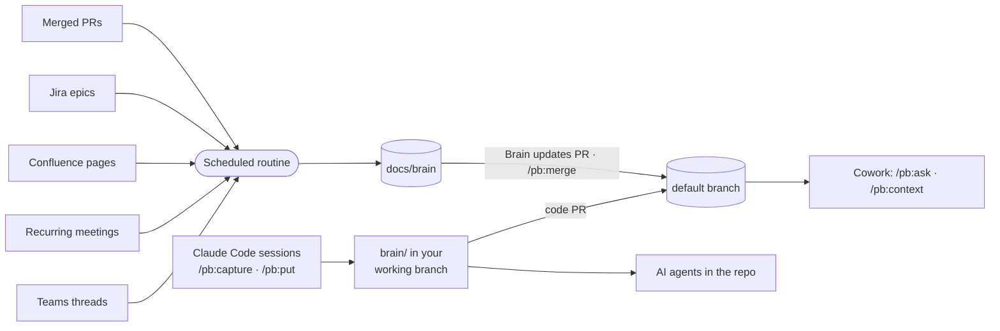

<div align="center">

# 🧠 Project Brain

**Your product team's shared memory, inside the repo, for people and AI agents.**

A Claude plugin that turns Teams threads, Confluence analyses, Jira epics and developer sessions<br>
into a linked wiki of features, glossary, roles, decisions and the technical knowledge the code cannot tell, right next to your code.

[](LICENSE)
[](#-install)
[](#-install)
[](#-set-up)

[Install](#-install) · [Set up](#-set-up) · [How saving works](#-how-saving-works) · [What you get for free](#-what-you-get-for-free) · [Commands](#-commands) · [Upgrading](#-upgrading) · [Troubleshooting](#-troubleshooting)

</div>

---

## ✨ Why

Decisions get made in a Teams thread, requirements live in a Confluence page, the reasons behind the code sit in someone's head. AI agents working on your repo see none of it.

Project Brain collects that context into `brain/`, a folder of plain Markdown pages in your monorepo, versioned with the code it explains. It keeps only what matters, keeps it short, and links it all together.

| Who | Where | How they use it |
|---|---|---|
| 👩‍💻 **Developers** | Claude Code | Read and write the brain in their working branch; the pages reach the default branch with the code PR |
| 🧑‍🎨 **PMs, designers, analysts, QA** | Claude Cowork | Read-only, from the default branch: ask questions and get context through the GitHub connector |
| 🛠 **Maintainer** | Claude Code | Brings what the routine wrote to the default branch with `/pb:merge` |
| 🤖 **AI agents** | Any session in the repo | Read `brain/AGENTS.md` and the context packs before touching code |



## 🗂 What's in the brain

`/pb:init` tailors the schema to your product, starting from this default:

| Part | Pages | Holds |
|---|---|---|
| **Functional** | `concept` → `glossary.md` | The product's vocabulary, in the languages you choose, with the lifecycle of each entity |
| | `feature` → `features.md` | The feature catalogue, grouped by capability, with status and roles |
| | `role` | Who uses the product, their goals, what they may do and why |
| | domain types | Chosen at init after a few questions on your domain: business `rule`s, `regulation`s, end-to-end `process`es, `edition`s, `metric`s, or types designed for it |
| **Technical** | `module`, `interface`, `integration`, `environment` | **All and only** what the code cannot tell: boundaries and non-goals, invariants, pitfalls, direction, contract semantics, how external systems really behave |
| **Across** | `epic`, `decision`, `open-question` | Work in progress, choices with their reasons, unanswered questions and contradictions |

## 📦 Install

<details open>
<summary><b>Claude Code</b></summary>

```
/plugin marketplace add minox86/project-brain
/plugin install pb@project-brain
```

</details>

<details open>
<summary><b>Claude Cowork, just for you</b></summary>

1. Open **Customize** in the sidebar, then **Plugins**.
2. Select **Add marketplace** and enter `minox86/project-brain`.
3. Find **pb** and click **Install**.
4. Connect the **GitHub** connector with read access to your product monorepo. Cowork reads the brain from there.

</details>

<details>
<summary><b>Claude Cowork, for the whole team</b> (organization Owner)</summary>

Organization marketplaces must be **private or internal** repositories on github.com.

1. Fork or mirror this repo as a private repo in your GitHub organization.
2. Sync it from **Organization settings → Plugins**.
3. Make `pb` available, or required, for the product team.

Cowork and Skills must be enabled for the organization.

</details>

## 🚀 Set up

Once per product.

### 1 · Create the brain

> **Who:** a developer or the Engineering Manager, in Claude Code, ideally a repo admin · **Needs:** the plugin installed, Python 3.9+, git, `gh` logged in

1. Open the monorepo and run **`/pb:init`**. Your checkout is not touched: init works in a temporary copy.
2. Claude looks at the repo, then asks a few rounds of questions to shape the wiki around your product, including which parts of it need a human review and who reviews technical, functional and design changes. The recommended answer is always the first option.
3. Confirm the schema. Claude then lists the documentation already in the repo (READMEs, `docs/`, architecture notes…) and offers to ingest all of it into the schema you chose: it summarises and links each doc (`repo:<path>`), merges what overlaps and turns disagreements into open questions.
4. Claude opens an ordinary PR from the branch `pb/init` with `brain/` and the first pages, the `pb-validate` workflow, a pointer in `CLAUDE.md` and `.claude/settings.json`, which offers the plugin to everyone who opens the repo in Claude Code. It also offers to make product pipelines skip brain-only PRs, in a separate PR.
5. Merge the PR. Developers get the brain in their branches as soon as they bring the default branch in. A new developer's computer is prepared once with **`/pb:setup`**.

> [!TIP]
> Make `validate` and `brain-only` (from `pb-validate`) required checks on the default branch: they run on every PR and pass when no brain page changed.

### 2 · Set up the routine

> **Who:** the Engineering Manager, in Claude Code · **Needs:** Microsoft 365 and Atlassian connectors

1. Run **`/pb:routine-setup`** and pick:
   - the Teams channels and Confluence spaces to read;
   - the recurring meetings to follow (refinement, design review, demo…): they need transcription on and the routine owner invited;
   - the Jira projects whose epics to follow;
   - how often it runs: every night (default), weekdays only, a few times a day, every N hours, once a week, or a custom schedule. At most once an hour.
2. Claude checks that `docs/brain` accepts the routine's pushes, creates the routine (or prints the steps) and writes the configuration in your working tree: commit it and merge its PR, like any brain change.
3. Run **`/pb:routine-run`** for a first run, then `/pb:routine-run status` to see what was added and what was skipped.

## 💾 How saving works

- **Pages are written in your branch.** Every `pb` skill writes in `brain/` of your checkout, on the branch you are on, checks the pages and rebuilds the generated files. pb never commits, pushes or switches branch: commit the pages with your code (or ask Claude to), and they reach the default branch with your PR, under the same review as the code. On the default branch pb writes anyway and reminds you that the pages need a branch and a PR.
- **Watched points name their reviewers.** When a change touches a point listed in `brain/schema/review.md` (decisions, interfaces, feature status…), the schema or the toolkit, Claude tells you at save time, and CI's `review` job requests the area reviewers on the PR. It informs; your branch protection decides what blocks.
- **The routine has its own lane.** The routine, `/pb:sync` and `/pb:routine-run --local` write only on the branch `docs/brain`, never in your checkout, and keep one PR open: "Brain updates". Nothing merges by itself.
- **`/pb:merge` brings the routine's knowledge in.** The maintainer runs it when they want it on the default branch: it brings the default branch into `docs/brain`, combines pages changed on both sides, settles inconsistencies (and asks when the sources do not), then merges "Brain updates". Their checkout is not touched.
- **Generated-file conflicts are cheap.** Two PRs that both touch the brain often conflict on `index.md`, `glossary.md` and the other generated files: take either side, run `PB generate` (`python3 brain/.pb/toolkit/pb.py generate`), commit. CI fails a PR whose generated files are stale.

## 🎁 What you get for free

Once the brain and the routine are set up, these happen without anyone running a command:

- 🔄 **Teams, Confluence and Jira flow in on schedule.** The routine keeps only what is worth remembering (decisions, requirement clarifications, domain explanations, open questions). It never copies messages verbatim and writes a digest of what it added and skipped.
- 🎙️ **Recurring meetings are captured.** After each refinement or design review, the routine reads the transcript and keeps the decisions and open questions. The transcript itself is never stored.
- 🎯 **Epics stay in sync.** Discussions that mention a Jira epic key are filed under that epic. When the epic is done, what still matters moves to the feature and decision pages.
- 🤖 **Every Claude session in the repo knows the brain**, even without the plugin. `CLAUDE.md` points to `brain/AGENTS.md`. Claude then:
  - uses the glossary terms;
  - starts from the context of your feature or epic;
  - follows accepted decisions;
  - flags code that contradicts the brain.
- ✅ **The brain checks itself.** Every save checks the pages it touches: malformed pages, broken links (also to pages being deleted), anything that looks like a password or token. CI checks the changed pages again and that the generated files are fresh, and fails "Brain updates" if `docs/brain` carries code.
- 🔇 **Noise is caught as it is written.** New pages that look like an existing one, pages nobody links, claims without a source, dated "update" sections, status talk ("this sprint", "TODO") and long verbatim quotes are flagged before the save.
- 👀 **Sensitive changes reach the right reviewer.** `brain/schema/review.md`, written by `/pb:init` and changed with `/pb:schema`, lists the points that need a human and who reviews technical, functional and design changes; they are asked on the PR that carries the change.
- 📏 **Your commit rules are followed.** `/pb:init` reads the repo's commitlint, hooks and PR checks and sets the format of every commit and PR title pb makes; a hook is never bypassed.
- 📚 **Indexes stay fresh.** Every save rebuilds the index, the glossary (in the languages you chose), the feature catalogue and a context pack for every feature and active epic.
- 🧹 **Old items step aside.** The routine marks superseded decisions, answered questions and closed epics as archived after a while, and they leave the index. Git keeps the history.
- 💬 **No commands to remember.** Ask in plain words: *"what did we decide about approvals?"*, *"save this decision in the brain"*, *"give me the context for FIN-412"*.

## 🛠 Commands

**In Claude Code (developers and maintainers)**

| You want to… | Say it, or run |
|---|---|
| Prepare your computer | `/pb:setup [owner/repo]` |
| Get context before a ticket | `/pb:context FIN-412` (or a feature, an epic, file paths) |
| Ask something | `/pb:ask why do invoices have a single approver?` |
| Save what you learned in this session | `/pb:capture` |
| Add a document, Confluence page, Jira ticket, PR or link | `/pb:put <text \| file \| confluence:… \| jira:KEY \| gh:pr/N \| url>` (`--as <type>`, `--plan` to preview) |
| Save a one-off Teams meeting | `/pb:meeting last` (or `today`, a Teams link, a meeting name) |
| Correct something wrong | `/pb:fix <what is wrong and what is right>` |
| Bring in what changed in the sources now | `/pb:sync [teams] [confluence] [github] [jira] [meetings]` (`--check` to preview; writes on `docs/brain`) |
| Clean up the brain | `/pb:lint --fix` |
| Run the routine now | `/pb:routine-run` (`--local` to run it here, `--check` to preview, `status` for the last run) |
| Set up or change the routine | `/pb:routine-setup` (`show`, `schedule every 4 hours`) |
| Bring the routine's changes to the default branch | `/pb:merge` |
| Change the wiki structure | `/pb:schema` (`show`, `propose`, `apply P3`, or the change in plain words) |
| Create the brain, or upgrade an older one | `/pb:init [product name]` |

**In Cowork (read-only)**

| You want to… | Say it, or run |
|---|---|
| Ask something | `/pb:ask what is still open on multi-level approval?` |
| Get the full context | `/pb:context <feature, epic or Jira key>` |

> [!TIP]
> Cowork only reads the brain. To add knowledge, write where you already do: analyses on Confluence, discussions in the Teams channel. Mention the Jira epic key and the routine files the content under that epic.

## ⬆️ Upgrading

- **The plugin:** `/plugin marketplace update project-brain`, then reinstall or update `pb`. Then ask Claude to run `pb toolkit-sync` and save it: CI and the cloud routine use the copy in `brain/.pb/toolkit/`. Commit it and merge its PR; the routine uses it once `docs/brain` has it (after `/pb:merge` if `docs/brain` is behind).
- **The default schema** (0.4: roles, integrations, capabilities, a technical part limited to what the code cannot tell, domain types): an existing brain keeps its own schema in `brain/schema/`. To adopt any of it, ask `/pb:schema` (e.g. *"add the role and integration types"*, *"add business rules"*).
- **From 0.4 or earlier:** merge the open "Brain updates" PR, update the plugin, then run `/pb:init`: through an ordinary PR it removes the workflow that merged the default branch back into `docs/brain`, updates `pb-validate` and the vendored toolkit. Once it is merged, run `/pb:routine-setup` again, so the routine follows the new prompt.

## 🩺 Troubleshooting

| Symptom | What to do |
|---|---|
| A connector is missing (Atlassian, Microsoft 365, GitHub) | The command names it, shows how to connect it and offers a workaround. In Cowork: **Customize → Connectors**. Some connectors need an organization Owner to enable them. |
| Cowork says the brain is not reachable | Connect GitHub with read access to the monorepo |
| A save is refused | Claude shows why (a broken page, a secret, a link to a deleted page) and fixes it with you |
| "no brain/ in this checkout" | Your branch was cut before the brain arrived: bring the default branch into it (or, with no brain anywhere, `/pb:init`) |
| The brain in my code branch is old | It is the brain as of your branch: bring the default branch in to get what others merged |
| The brain PR is in conflict, or `docs/brain` is behind | `/pb:merge` |
| CI says generated files are stale, or they conflict | Take either side, run `python3 brain/.pb/toolkit/pb.py generate`, commit |
| A commit was rejected by the repo's rules | Claude rewrites the message to satisfy them and retries (the nightly routine reports it instead); fix the format for good with `/pb:schema` (`commit_format`, `commit_rules`) |
| "Reviewers not requested" on a PR | Check the handles in `brain/schema/review.md` (`/pb:schema`); the review is in the job summary anyway |
| Nothing was added overnight | `/pb:routine-run status`, then "Problems" in the latest digest |
| Wrong information | `/pb:fix` in Claude Code |

<div align="center">
<sub>MIT licensed · built for <a href="https://claude.com/claude-code">Claude Code</a> and Claude Cowork</sub>
</div>
