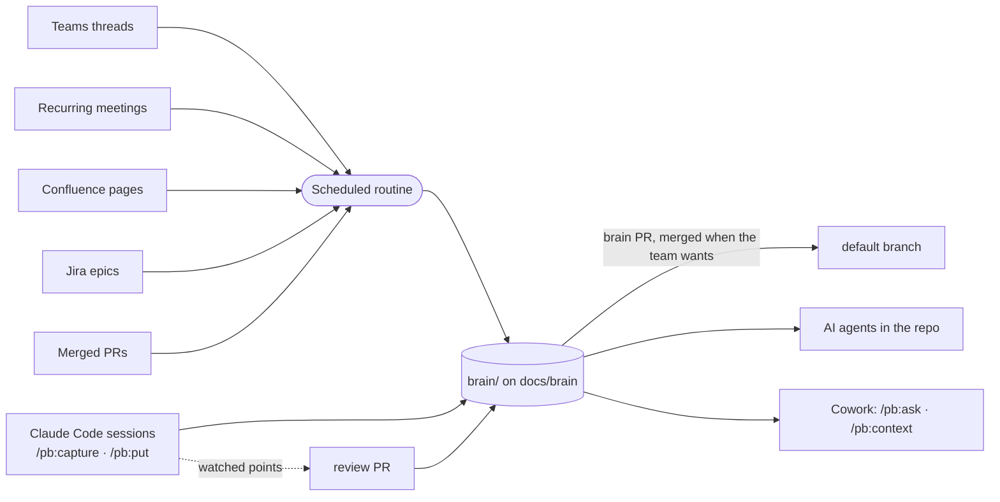

<div align="center">

# 🧠 Project Brain

**Your product team's shared memory, inside the repo, for people and AI agents.**

A Claude plugin that turns Teams threads, Confluence analyses, Jira epics and developer sessions<br>
into a linked wiki of features, epics, concepts, modules and decisions, right next to your code.

[](LICENSE)
[](#-install)
[](#-install)
[](#-set-up)

[Install](#-install) · [Set up](#-set-up) · [How saving works](#-how-saving-works) · [What you get for free](#-what-you-get-for-free) · [Commands](#-commands) · [Upgrading](#-upgrading) · [Troubleshooting](#-troubleshooting)

</div>

---

## ✨ Why

Decisions get made in a Teams thread, requirements live in a Confluence page, the reasons behind the code sit in someone's head. AI agents working on your repo see none of it.

Project Brain collects that context into `brain/`, a folder of plain Markdown pages in your monorepo, on its own branch `docs/brain`. It keeps only what matters, keeps it short, and links it all together.

| Who | Where | How they use it |
|---|---|---|
| 👩‍💻 **Developers** | Claude Code | Read and write the brain; their working branch is never touched |
| 🧑‍🎨 **PMs, designers, analysts, QA** | Claude Code (desktop app) | Read and write the brain without knowing git: `/pb:setup` prepares the computer once |
| 👀 **Anyone, read-only** | Claude Cowork | Ask questions and get context through the GitHub connector |
| 🤖 **AI agents** | Any session in the repo | Read `brain/AGENTS.md` and the context packs before touching code |



## 📦 Install

<details open>
<summary><b>Claude Code</b></summary>

```
/plugin marketplace add minox86/project-brain
/plugin install pb@project-brain
```

</details>

<details open>
<summary><b>Claude Cowork, just for you</b></summary>

1. Open **Customize** in the sidebar, then **Plugins**.
2. Select **Add marketplace** and enter `minox86/project-brain`.
3. Find **pb** and click **Install**.
4. Connect the **GitHub** connector with read access to your product monorepo. Cowork reads the brain from there, on the branch `docs/brain`.

</details>

<details>
<summary><b>Claude Cowork, for the whole team</b> (organization Owner)</summary>

Organization marketplaces must be **private or internal** repositories on github.com.

1. Fork or mirror this repo as a private repo in your GitHub organization.
2. Sync it from **Organization settings → Plugins**.
3. Make `pb` available, or required, for the product team.

Cowork and Skills must be enabled for the organization.

</details>

## 🚀 Set up

Once per product.

### 1 · Create the brain

> **Who:** a developer or the Engineering Manager, in Claude Code, ideally a repo admin · **Needs:** the plugin installed, Python 3.9+, git, `gh` logged in

1. Open the monorepo and run **`/pb:init`**. Your checkout is not touched: init works in a temporary copy.
2. Claude looks at the repo, then asks a few rounds of questions to shape the wiki around your product, including which parts of it need a human review and who reviews technical, functional and design changes. The recommended answer is always the first option.
3. Claude checks GitHub: `docs/brain` must not be covered by a branch protection or ruleset, and workflows must be allowed to push. It applies what it can (as an admin) or lists it for an admin. It also offers to make product pipelines skip brain-only changes.
4. Confirm. Claude creates the branch `docs/brain` with `brain/` and the first pages, and opens the **brain PR** from `docs/brain` to your default branch. Besides the brain, this first PR brings the two pb workflows, a pointer in `CLAUDE.md` and `.claude/settings.json`, which offers the plugin to everyone who opens the repo in Claude Code.
5. Merge the brain PR.

> [!TIP]
> Make `validate` and `brain-only` (from `pb-validate`) required checks on the default branch: they run on every PR and pass when no brain page changed.

### 1b · Everyone else

> **Who:** each person who will use the brain, in Claude Code (the desktop app is fine) · **Needs:** write access to the monorepo

Install the plugin (above), then run **`/pb:setup`**. Claude installs what is missing (git, Python, GitHub CLI), signs you in to GitHub, sets your git identity, clones the monorepo, proposes the permissions that keep it quiet and checks that you can read the brain. Then ask the brain anything, or save what you know: no git involved.

### 2 · Set up the routine

> **Who:** the Engineering Manager, in Claude Code · **Needs:** Microsoft 365 and Atlassian connectors

1. Run **`/pb:routine-setup`** and pick:
   - the Teams channels and Confluence spaces to read;
   - the recurring meetings to follow (refinement, design review, demo…): they need transcription on and the routine owner invited;
   - the Jira projects whose epics to follow;
   - how often it runs: every night (default), weekdays only, a few times a day, every N hours, once a week, or a custom schedule. At most once an hour.
2. Claude creates the routine (or prints the steps) and saves the configuration. Configuration is always reviewed: merge the review PR it links.
3. Run **`/pb:routine-run`** for a first run, then `/pb:routine-run status` to see what was added and what was skipped.

## 💾 How saving works

- **Every save goes straight to `docs/brain`,** so everyone sees it at once. Your working branch and your uncommitted code are never touched: pb works in its own copy of the brain inside the clone's git folder.
- **Watched points wait for a reviewer.** Pages on points listed in `brain/schema/review.md` (decisions, interfaces, feature status…), and every change to the schema or the toolkit, go to a **review PR** towards `docs/brain`, with the area reviewers. Merge it to accept, edit the pages in it to correct them, close it to drop them.
- **The brain PR carries the brain to the code.** pb opens a PR from `docs/brain` to the default branch with the first save after the previous one was merged. Merge it when you want the code branches to carry the brain, with any merge method: the `pb-brain-branch` workflow then brings the default branch back into `docs/brain`. Until then, `brain/` in a code branch can be a few days behind; the `pb` skills always read the latest.
- **Conflicts are handled for you.** If someone changed the same page meanwhile, Claude merges both versions.
- **Offline is fine.** The save waits on your computer and goes out with the next one.
- **Only what you confirmed is saved.** Pages another session is still writing stay out of your save.

## 🎁 What you get for free

Once the brain and the routine are set up, these happen without anyone running a command:

- 🔄 **Teams, Confluence and Jira flow in on schedule.** The routine keeps only what is worth remembering (decisions, requirement clarifications, domain explanations, open questions). It never copies messages verbatim and writes a digest of what it added and skipped.
- 🎙️ **Recurring meetings are captured.** After each refinement or design review, the routine reads the transcript and keeps the decisions and open questions. The transcript itself is never stored.
- 🎯 **Epics stay in sync.** Discussions that mention a Jira epic key are filed under that epic. When the epic is done, what still matters moves to the feature and decision pages.
- 🤖 **Every Claude session in the repo knows the brain**, even without the plugin. `CLAUDE.md` points to `brain/AGENTS.md`. Claude then:
  - uses the glossary terms;
  - starts from the context of your feature or epic;
  - follows accepted decisions;
  - flags code that contradicts the brain.
- ✅ **The brain checks itself.** Every save is checked before it leaves your computer: malformed pages, broken links (also to pages being deleted), anything that looks like a password or token. CI checks the changed pages again, and fails the brain PR if `docs/brain` carries code.
- 🔇 **Noise is caught as it is written.** New pages that look like an existing one, pages nobody links, claims without a source, dated "update" sections, status talk ("this sprint", "TODO") and long verbatim quotes are flagged before the save.
- 👀 **Sensitive changes wait for the right reviewer.** `brain/schema/review.md`, written by `/pb:init` and changed with `/pb:schema`, lists the points that need a human and who reviews technical, functional and design changes.
- 📚 **Indexes stay fresh.** Every save rebuilds the index, the glossary (in the languages you chose) and a context pack for every feature and active epic.
- 🧹 **Old items step aside.** Superseded decisions, answered questions and closed epics leave the index after a while. Git keeps the history.
- 💬 **No commands to remember.** Ask in plain words: *"what did we decide about approvals?"*, *"save this decision in the brain"*, *"give me the context for FIN-412"*.

## 🛠 Commands

**In Claude Code (everyone)**

| You want to… | Say it, or run |
|---|---|
| Prepare your computer | `/pb:setup [owner/repo]` |
| Get context before a ticket | `/pb:context FIN-412` (or a feature, an epic, file paths) |
| Ask something | `/pb:ask why do invoices have a single approver?` |
| Save what you learned in this session | `/pb:capture` |
| Add a document, Confluence page, Jira ticket, PR or link | `/pb:put <text \| file \| confluence:… \| jira:KEY \| gh:pr/N \| url>` (`--as <type>`, `--plan` to preview) |
| Save a one-off Teams meeting | `/pb:meeting last` (or `today`, a Teams link, a meeting name) |
| Correct something wrong | `/pb:fix <what is wrong and what is right>` |
| Bring in what changed in the sources now | `/pb:sync [teams] [confluence] [github] [jira] [meetings]` (`--check` to preview) |
| Clean up the brain | `/pb:lint --fix` |
| Run the routine now | `/pb:routine-run` (`--local` to run it here, `--check` to preview, `status` for the last run) |
| Set up or change the routine | `/pb:routine-setup` (`show`, `schedule every 4 hours`) |
| Change the wiki structure | `/pb:schema` (`show`, `propose`, `apply P3`, or the change in plain words) |
| Create the brain, or move an older one | `/pb:init [product name]` |

**In Cowork (read-only)**

| You want to… | Say it, or run |
|---|---|
| Ask something | `/pb:ask what is still open on multi-level approval?` |
| Get the full context | `/pb:context <feature, epic or Jira key>` |

> [!TIP]
> Cowork only reads the brain. To add knowledge, use Claude Code (`/pb:setup` prepares it once), or write where you already do: analyses on Confluence, discussions in the Teams channel. Mention the Jira epic key and the routine files the content under that epic.

## ⬆️ Upgrading

- **The plugin:** `/plugin marketplace update project-brain`, then reinstall or update `pb`. Then ask Claude to run `pb toolkit-sync` and save it: CI and the cloud routine use the copy in `brain/.pb/toolkit/`, and the change goes to a review PR. They use the new version once it is merged.
- **From a version with the brain on the default branch** (0.1): everyone updates the plugin; a maintainer runs `/pb:init`, which moves the brain to `docs/brain` and opens the brain PR (merge it), then `/pb:routine-setup`, so the routine writes to `docs/brain` (merge its review PR). Pages written in code branches before the move reach the default branch with their PRs, and `docs/brain` at the next brain PR merge.

## 🩺 Troubleshooting

| Symptom | What to do |
|---|---|
| A connector is missing (Atlassian, Microsoft 365, GitHub) | The command names it, shows how to connect it and offers a workaround. In Cowork: **Customize → Connectors**. Some connectors need an organization Owner to enable them. |
| Cowork says the brain is not reachable | Connect GitHub with read access to the monorepo, branch `docs/brain` included |
| "Saved on this computer" | You were offline: the next save sends it |
| "Another Claude session is working on the brain" | Two sessions saved at once: retry in a moment |
| A save is refused | Claude shows why (a broken page, a secret, a link to a deleted page) and fixes it with you |
| "Reviewers not requested" on a review PR | Check the handles in `brain/schema/review.md` (`/pb:schema`); the PR is open anyway |
| The brain in my code branch is old | It arrives with the brain PR; the `pb` skills always read the latest |
| `pb-brain-branch` failed | Usually the default branch changed GitHub workflows, which the workflow token cannot push: add a `PB_BRAIN_TOKEN` secret (a token with contents and workflows write on the repo) and re-run it from the Actions tab, or have a developer merge the default branch into `docs/brain` |
| Nothing was added overnight | `/pb:routine-run status`, then "Problems" in the latest digest |
| Wrong information | `/pb:fix` in Claude Code |

<div align="center">
<sub>MIT licensed · built for <a href="https://claude.com/claude-code">Claude Code</a> and Claude Cowork</sub>
</div>
